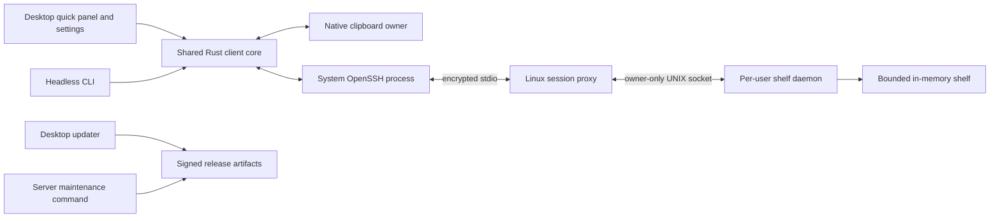

# SSH Clipboard Architecture

## Purpose

Describe the delivered Windows/Apple Silicon desktop and Linux server rework. SSH remains the transport and account boundary. The desktop provides a discoverable quick panel, usable settings, temporary history and signed updates.

**Status: Windows/Apple Silicon desktop 0.4.2 published; Linux 0.4.0 server cut over.** The new desktop supports explicit transfers, saved settings, history and signed updates. The signed managed shelf now serves history and the legacy compatibility socket. The owner selected and saved the installed desktop's history endpoint. [The implementation plan](docs/implementation-plan.md) closes the agreed delivery and records deferred platforms and non-blocking evidence limits. The [Phase 1 prototype guide](docs/desktop-prototype.md) retains source-build context.

Clean Windows/Mac client and Linux server cutovers are accepted, with the old active installations retired and private recovery backups retained. Package/source identities, native results and untested limits remain in the [release record](docs/release-readiness.md), [Mac cutover](docs/macos-cutover.md), [Mac updater rehearsal](docs/macos-updater-acceptance.md) and [Linux cutover](docs/linux-cutover-acceptance.md). Architecture describes current boundaries; those reports retain the installation history.

## Scope Closure and Legacy Retirement

On 2026-10-18 the owner deferred Linux desktop/AppImage/Wayland work and further broad manual testing of rare scenarios. Existing automated coverage and recorded gaps remain; no reboot, deployment or native test campaign is scheduled. All eight implementation phases are closed for Windows x64, Apple Silicon and the Linux x64 server.

The old tray agent is retired from default builds and automatic releases. Normal source builds provide the clipboard CLI; the agent remains available only with explicit `--features agent` for 0.4 compatibility. Its automatic `v*` publisher is removed. V2 routes and legacy import stay because current CLI/profile/server contracts use them. Published archives and private recovery backups remain. See [legacy retirement](docs/legacy-retirement.md).

## Key Files

- `src/client/`, `src/client_actions.rs`: clipboard adapters and SSH transfers.
- `desktop/`: shipped Tauri/Svelte desktop; `src/agent/` and its binary are opt-in retired compatibility code.
- `src/protocol.rs`, `src/framing.rs`: preserved V2 one-shot compatibility contract.
- `src/shelf.rs`, `src/shelf_service/`, `src/session_protocol/`: temporary history and negotiated session contract.
- `src/shelf_daemon.rs`, `src/session_proxy.rs`, `src/server_management.rs`: Linux shelf endpoint and signed maintenance.
- `src/daemon.rs`, `src/proxy.rs`: retained single-item daemon/proxy compatibility.
- `src/cli/`: commands, diagnostics, configuration, and installation.
- `.github/workflows/ci.yml`, `desktop-release.yml`, `server-release.yml`: regression checks and protected signed packaging.
- [Implementation plan](docs/implementation-plan.md): completed phases, retirement decision and deferred scope.

## Current System

The desktop uses the shared Rust client core and system OpenSSH. A shelf profile runs the session proxy on Linux, which bridges encrypted stdio to the private per-user daemon socket. The daemon holds bounded temporary text/PNG history; it does not persist clipboard payloads to disk. The desktop owns one foreground connection for explicit operations and a separate metadata connection for snapshot/Watch. Background recovery refreshes metadata without fetching payloads, sampling the local clipboard or replaying a transfer.

The panel provides explicit Share/Copy, history selection, inert previews, confirmed delete/clear, connection state and settings. A dedicated worker retains native clipboard ownership until Quit. Close hides the panel; tray/menu, launcher and the configured panel shortcut open it. Optional direct shortcuts act only while the panel is in the background. Registration/notification failures retain visible entry points and panel feedback. See [history](docs/desktop-history.md), [shortcuts](docs/desktop-shortcuts.md) and [notifications](docs/desktop-notifications.md).

Desktop and CLI share schema-versioned connection profiles, preferences, transport policy and device identity. Bounded reads, coordinated writers, snapshot checks and atomic replacement protect concurrent edits. Existing shared settings take precedence over legacy discovery. Migration preserves original bytes in exact backups; a one-time import review does not take over startup automatically. See [configuration](docs/shared-configuration.md) and [migration](docs/configuration-migration.md).

The client validates correlated replies, drains bounded stderr, enforces deadlines and reaps failed children. Profile/revision/generation guards reject stale events and previews. Cancellation distinguishes an acknowledged result from an uncertain mutation; status lookup and explicit frozen-capture retry share a server-enforced deadline. See [diagnostics](docs/connection-diagnostics.md), [persistent sessions](docs/persistent-sessions.md) and [share recovery](docs/share-recovery.md).

V2 profiles and CLI push/pull/peek retain a one-shot proxy route. The optional V2 adapter maps Set/Get/PeekMeta to the shelf's latest item. The original standalone single-value daemon/proxy also remains available for compatibility. V2 frames retain SCB1/version 2, correlated IDs and locked wincode fixture bytes. Their defaults remain a 10 MiB frame and 64 MiB decoded-image limit, with the existing response serialization allowance. See [protocol](docs/protocol.md) and [released compatibility](docs/released-compatibility.md).

Linux listeners use owner-only directories/sockets and UID checks, and refuse to unlink an active daemon's endpoint. Managed installation pins its socket paths and keeps its executable/unit outside extracted download folders. Desktop updates and server maintenance use signed exact package bytes; their installations and release approvals remain independent.

## Product Contract

- A compact **quick panel** is the primary interface. The tray/menu and normal application launcher open it; one configurable shortcut opens it too.
- The panel shows the latest shared item, a small recent list, source device, receipt time, connection state, and clear **Share current clipboard** / **Copy to this computer** actions.
- Sharing and copying are explicit by default. Opening the panel does not upload the local clipboard or replace it with remote content.
- Settings have Connection, Shortcuts, Behavior, and Updates pages, with validated changes applied without restarting.
- SSH aliases, keys, agent, host verification, and configuration continue to work through system OpenSSH.
- Free cryptographic update signing is required. Paid OS publisher certificates/notarization are a separate distribution decision.

Continuous synchronization, full local clipboard history, accounts/cloud relays, arbitrary file transfer, and a full mesh of peers are outside the initial rework. Rich clipboard formats can be added after text and images are reliable.

## Component Boundaries

### Shared Rust Client Core

Own typed configuration, profile selection, item models, connection state, transport, transfer orchestration, and diagnostics. Desktop and CLI use the same services and configuration schema. Keep OS clipboard work behind an adapter so the headless server has no GUI or clipboard dependencies.

The desktop owns the long-lived clipboard adapter/event loop. On platforms where clipboard contents require a live owner, successful copy means another application can still paste after the panel closes. CLI clipboard writes need a deliberate ownership strategy; stdout/file exports remain usable without a desktop session.

### Desktop Shell

Tauri 2 with Svelte/TypeScript is the shipped desktop framework. The Rust backend owns SSH, clipboard, filesystem, configuration, and update operations. The frontend receives typed state and invokes narrowly scoped commands; it does not receive general shell execution privileges. Render clipboard content as inert text/images, never executable HTML.

Use one app instance, a tray/menu, a compact panel, a settings window, and an ordinary launcher entry. Shortcut registration failure must leave these entry points working. Linux desktop/portal work is deferred. Existing cross-platform compilation does not establish native Linux desktop support.

### Linux Proxy and Daemon

Retain a per-user daemon and local UNIX socket with restrictive permissions and UID verification. The proxy bridges bounded protocol messages across stdio; it must keep diagnostics on stderr. Desktop sessions support multiple requests and change notifications. CLI sessions may remain short-lived.

Protect daemon startup with exclusive ownership and stale-socket detection. Starting a second daemon must fail clearly instead of unlinking an active daemon's socket. Configuration and installation data may persist; clipboard items do not persist by default.

## Shared Item Model and Shelf

The shelf item descriptor contains:

| Field | Responsibility |
| --- | --- |
| Item ID | Stable server-assigned identity, independent of list position. |
| Origin | Client device ID and user-editable display name; descriptive, not a separate authentication identity. |
| Receipt/expiry | Server receipt time and expiry time; server ordering does not trust device clocks. |
| Sequence/epoch | Ordering and restart detection for snapshots and notifications. |
| Representations | MIME type, encoded size, and bytes per representation; initial support is text and PNG. |
| Display label | Short deterministic content preview, with an optional explicit user label later. |

Representations allow future text/HTML/RTF alternatives without conflating them with separately copied items. Support for multiple native formats is enabled only when the relevant adapter and protocol capability are verified.

The shelf contains only items explicitly shared with it. Default retention is 20 items, one hour, and a 256 MiB aggregate encoded-payload budget. Expire items and evict the oldest first under count/byte pressure. Deletion and clearing are explicit actions. Restart clears the shelf and changes its epoch.

Per-item encoded limits, decoded image limits, metadata limits, and aggregate/per-connection memory budgets are separate. Account for temporary decode buffers, snapshots, and queued messages; limiting stored payload bytes alone does not bound process memory. Oversized uploads are rejected before committing an item.

Native image testing exposed the legacy 10 MiB transfer default as restrictive. Shelf defaults allow 64 MiB encoded items and a 256 MiB decoded-image budget, with separate resident/transient bounds; frames also reserve bounded metadata space. See [implemented limits](docs/shelf-core.md#model-and-defaults). Advertise effective server limits and apply them across client, proxy, and daemon. Legacy compatibility keeps its existing limits until deliberately configured together. Prefer lossless compression and actionable size reports; never silently reduce image dimensions or fidelity.

Labels are generated locally from the first nonempty text line or validated image dimensions. They do not imply knowledge of the source document's title. No AI service, page-title fetch, or OCR is required. Truncate display labels without altering the copied bytes. Device names are configured locally.

## Transfer and Connection Behavior

### Share

1. A user action captures the local clipboard once into supported representations.
2. The core validates content and sizes and assigns an upload operation ID.
3. The server validates and atomically commits the item, recording its receipt time and sequence.
4. The reply returns its stable ID; metadata notifications refresh other connected panels.

Retries reuse the operation ID for that captured payload. The server keeps a bounded, expiring deduplication record. After restart or expiry of that record, the client must show an uncertain outcome rather than claiming exactly-once delivery. Reconnection never samples and uploads the current clipboard automatically.

### Copy

1. The user selects an item and invokes Copy to this computer.
2. The core fetches that item by ID, validates it, and writes supported representations to the native clipboard.
3. The desktop retains clipboard ownership as needed. A fetched-but-not-copied item never produces a success message.

If the item has expired, report that and refresh the list. List notifications carry metadata; previews/payloads are fetched on demand and cached within explicit bounds. Closing the panel or switching profiles cancels obsolete fetches and removes previews from the previous profile.

### Connection State

Model disconnected, connecting, ready, reconnecting, and needs-action states separately from transfer state. Distinguish missing SSH, authentication/agent problems, host verification, missing proxy, unavailable daemon, incompatible protocol, and payload errors. Connection diagnostics must also work with a proxy-only forced-command key.

Drain SSH stderr concurrently with bounded capture, correlate response IDs, impose operation deadlines, support cancellation, and reap child processes. Use bounded queues; slow subscribers must reconnect and resnapshot rather than accumulating unbounded notifications. Use backoff for reconnects and refresh metadata after a new session.

## Protocol Evolution and Compatibility

Version 2 remains the legacy one-shot contract. Do not change its serialized fixture bytes silently. The separately selectable session-proxy entry point uses an SCBS bootstrap and JSON/raw-payload frames; see [session protocol](docs/session-protocol.md).

The handshake negotiates supported protocol ranges, capabilities, limits, server epoch, and shelf policy. The new contract covers share, list, fetch-by-ID, delete, clear, subscribe, and health. Request/reply correlation, event sequence ordering, bounded framing, cancellation and snapshot recovery govern persistent sessions.

The shelf server can explicitly enable a legacy endpoint alongside the session endpoint. A legacy `Get`/`PeekMeta` maps to the latest item; legacy `Set` produces a single-representation shelf item with unknown/legacy origin. New clients can explicitly use legacy mode with reduced capabilities. Do not silently fall back after authentication or host verification failure.

Negotiate capabilities rather than requiring identical application versions. Maintain a published supported-version window, and test desktop-first and server-first upgrades. Restricted keys may need a reviewed forced-command migration to expose the session endpoint; they never gain maintenance privileges as part of compatibility fallback.

## Configuration and Privacy

Use a versioned schema shared by desktop and CLI. Connection profiles select a server/account and optional logical shelf; each profile isolates connection state, metadata, previews, and pending operations. Named shelves, if implemented, remain within one SSH account's permissions and are not an access-control feature.

Apply flow: edit a draft, validate, test where useful, persist atomically, then activate. Preserve invalid/corrupt legacy files and report recovery options. Coordinate CLI/desktop writers, reconcile external changes, and avoid leaving persisted and active settings in disagreement if applying an OS integration fails.

Store SSH references, not passwords/private-key contents. Keep host verification enabled and route trust/authentication decisions through a deliberate SSH setup flow. Logs contain structured operation metadata and sanitized diagnostics, never clipboard contents. Previews remain local memory with bounded lifetime; disk history is opt-in future work.

## Installation and Updates

### Desktop

Installed-build staging now targets a stable per-user Windows NSIS location, bundles a version-matched CLI, and preserves configuration outside the application bundle. The isolated debug package build has passed without running the installer. Release-only startup controls read actual registration and apply explicit changes with coordinated settings/save rollback; retained/imported choices never register automatically. Isolated native Windows login and installed replacement pass with disposable trust; production 0.4.0 installation/text paste and actual login pass. The signed 0.4.1 overwrite upgrade preserves the saved connection, and native startup off/on creates the expected quoted command. Public Windows delivery passes. The protected Apple Silicon 0.4.2 package and owner Mac migration/text/login/shortcut acceptance also pass; isolated native Mac update/restart also passes, while Linux desktop packaging remains separate. See [packaging and startup evidence](docs/desktop-updates.md).

The installed runtime now checks stable metadata quietly through bounded HTTPS, shows inert notes/download status, and requires separate download/verification and install confirmation. Strict exact-byte and signed version/platform/channel policy precedes a one-use local metadata handoff to the framework installer; it never uses the framework's unbounded remote readers. Idle transfer/native ownership and uncertain-share guards protect replacement, with transport recovery after installer launch failure. A master-only environment-gated workflow stages signed drafts without publishing. Protected production signing, independent package verification and anonymous Windows public delivery now pass. Isolated native Windows replacement and installed signing-key transition pass. The dedicated private key and its password are retained in the owner's password manager, separate from SSH keys. See [trust and evidence](docs/desktop-updates.md).

A separate native updater rehearsal can compile a loopback transport into the exact Update Test app identity. Its build script rejects production/prototype identities and inherited staging inputs; normal builds contain no fixture dispatch. The rehearsal preserves canonical signed selectors and the bounded reader/real installer, while an owned capability-routed server supplies same-key and key-transition packages or injected network/byte faults. It never publishes or installs automatically and does not prove public HTTPS delivery. See [native rehearsal boundaries](docs/desktop-updates.md#isolated-native-updater-rehearsal).

Mac fixture builds additionally select a separate settings store and skip legacy discovery at compile time, so actual replacement/restart can be tested alongside the preserved production app. A credential-free CI job prepares two disposable signed archives; [Mac updater acceptance](docs/macos-updater-acceptance.md) records the successful installed replacement/restart, settings retention, production preservation and cleanup separately from package proof.

GitHub Releases is the initial distribution source. Windows/macOS use the desktop framework's supported updater packages. Linux desktop packaging/update work is deferred. Initial installation still needs a trusted source. HTTPS and checksums do not replace artifact signatures. Publisher signing/notarization is a separate decision and is not provided by updater signing.

The [documented key rotation policy](docs/releasing.md#key-rotation-and-recovery) requires a transition release trusted by old clients' existing key. Key loss/compromise may require a trusted manual reinstall. Signature verification alone does not solve replay; define version/channel checks and the authenticity of release metadata. Protect security-relevant metadata with an authenticated manifest where the chosen updater does not cover it. Normal updates cannot silently downgrade; recovery is a deliberate verified action.

### Server

Use user-owned versioned release directories and a stable launcher/service path instead of symlinks into an extracted download or a shared global binary. A maintenance command stages and verifies a signed server package, switches the active executable, restarts the service, checks health, and rolls back the executable if health fails.

The Linux `server-maintenance` namespace now exposes signed install/update, metadata status, explicit recovery, and read-only verification. It pins trust/UID/socket/limits, retains private immutable releases, generates a stable user launcher and actual unit, bounds downloads/processes, and journals executable selection before initial enable/restart. Health requires the selected version through the saved proxy/socket. Failed update restores the verified predecessor; failed first install disables the attempted service. Interrupted/failed outcome writes retain recovery state and block new updates. Disposable signed executable/real proxy tests and real user-systemd runtime acceptance pass, including crash-loop rate-limit rollback, journal recovery and owned cleanup. The exact signed 0.4.0 optimized artifact also passes independent admission, released-client compatibility, real SSH and isolated real-service install/restart checks. The exact signed live 0.4.0 persistent installation, SSH routes and old-install retirement now pass. Startup persistence is configured and public server delivery is verified; actual reboot/last-session logout remain unobserved and non-blocking. See [live acceptance](docs/linux-cutover-acceptance.md). See [maintenance evidence](docs/server-maintenance.md).

Signed server staging builds headless packages, authenticates canonical version/platform names, verifies them with the concrete policy and records source/key/hash evidence. The master-only `server-release` workflow creates protected Linux x64 drafts; protected production signing and independent exact-package verification passed after owner approval. Signed server 0.4.0 persistent installation and public delivery now pass; actual reboot/last-session logout retain their separate gap. Local synthetic-key package staging passes without installation.

Transfer-only keys remain transfer-only. Remote maintenance uses a separately authorized management connection, or the user runs the maintenance command on the server. Notify clients that restart clears the in-memory shelf; rollback restores the executable, not lost clipboard items. Client and server updates are independent within the supported compatibility window.

## Validation Boundaries

Protocol/configuration/shelf tests, real SSH integration, native desktop behavior, and packaged update tests provide different evidence. A green unit suite does not prove another application can paste on Wayland or that an installed application can update itself. Keep tested results and untested limits distinct. The [closed implementation plan](docs/implementation-plan.md) defers Linux desktop and further broad rare-scenario checks; future native checks are limited to a concrete change or observed issue.

## Update Triggers

- A shipped component changes or approved work alters its boundary.
- Framework, clipboard adapter, Linux capability support, or packaging decisions change.
- Retention defaults, protocol compatibility window, or trust policy are finalized.
- Migration, rollback, or platform validation reveals a new constraint.

## Related Docs

- [Implementation plan](docs/implementation-plan.md)
- [Protocol](docs/protocol.md)
- [Dependency decisions](docs/dependency-decisions.md)
- [Agent](docs/agent.md) and [Linux desktop](docs/linux-client.md)
- [Security](docs/security.md)
- [Server setup](docs/server-setup.md)
- [Releasing](docs/releasing.md) and [CI](docs/ci.md)
- [Testing](docs/testing.md)
- [Docs index](docs/index.md)
