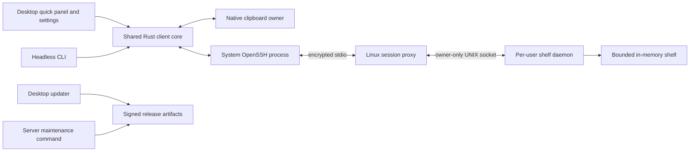

# SSH Clipboard Architecture

## Purpose

Describe the current implementation and the target architecture agreed during the October 2026 redesign discussion. SSH remains the transport and account boundary. The target is a small desktop clipboard utility with a discoverable quick panel, usable settings, and signed updates.

**Status: rework in progress.** The installed CLI/agent/server still implement the current system below. An isolated [Phase 1 desktop prototype](docs/desktop-prototype.md) now uses those transfer services; the target architecture is not yet implemented as a whole. [The implementation plan](docs/implementation-plan.md) defines the delivery sequence and acceptance checks. Existing feature documents describe shipped behavior until their corresponding phase lands.

## Key Files

- `src/client/`, `src/client_actions.rs`: clipboard adapters and SSH transfers.
- `src/agent/`, `src/bin/ssh_clipboard_agent.rs`: current desktop agent.
- `src/protocol.rs`, `src/framing.rs`: current version 2 wire protocol.
- `src/daemon.rs`, `src/proxy.rs`: Linux server and SSH bridge.
- `src/cli/`: commands, diagnostics, configuration, and installation.
- `.github/workflows/ci.yml`, `.github/workflows/release.yml`: checks and packaging.
- [Implementation plan](docs/implementation-plan.md): proposed work and delivery gates.
- `desktop/`: isolated Tauri/Svelte prototype with its own package and Cargo lockfiles.

## Current System

The Rust CLI and tray agent launch the system OpenSSH client for each operation. SSH runs `ssh_clipboard proxy` on Linux; the proxy forwards one request and response through a per-user UNIX socket to the daemon, then exits.

The daemon holds one `Option<ClipboardValue>` in memory. A successful `Set` replaces it; `Get` retrieves it; `PeekMeta` returns metadata. Each value contains one content type, bytes, and a client-supplied timestamp. UTF-8 text and PNG images are supported today. There is no shared history, expiry, subscription, or disk persistence.

Frames contain `SCB1`, version `2`, a little-endian length, and a `wincode` payload. Requests and responses carry request IDs. The default size limit is 10 MiB; current frame and decoded-image limits do not have identical semantics. The exact existing contract is in [protocol.md](docs/protocol.md), with compatibility fixtures in `src/protocol.rs`.

The daemon uses an owner-only socket directory (`0700`), socket (`0600`), and peer UID checks. Its preferred path is `$XDG_RUNTIME_DIR/ssh_clipboard/daemon.sock`, falling back to `$TMPDIR/ssh_clipboard-$UID/daemon.sock` or `/tmp/ssh_clipboard-$UID/daemon.sock`.

The installed agent provides tray actions, separate push/pull hotkeys, notifications, and start-at-login. Settings are file/CLI based and loaded at startup. Installed CLI transfers do not inherit the agent configuration. Release archives have SHA256 checksums but no built-in signed updater. On the rework branch, CLI transfers can use the new shared profile store, described below.

The new prototype has a compact panel, explicit share/refresh/copy, inert text/image previews, persistent settings, tray access, a single-instance launcher callback, and configurable panel/optional direct shortcuts. A dedicated worker retains its clipboard adapter until Quit. Existing profiles keep version 2 one-shot transfers and the single server value. An explicit per-profile shelf mode now adds history selection, epoch-guarded delete/clear, revalidated selected-item copy, and bounded/private server-derived labels; see [desktop history](docs/desktop-history.md). This source integration has automated/browser evidence; a new real SSH/native acceptance pass remains open. Phase 2 adds `src/configuration.rs`: a shared versioned profile/preferences schema with bounded reads, coordinated writers, stale-edit rejection, and atomic file replacement. The prototype uses a separate user configuration file. Schema 1 upgrades are backed up before writes; missing shared settings can initialize from a losslessly backed-up legacy agent file, preserving connection policy and startup/shortcut choices without rewriting that file or OS registrations. Schema 2 carries advanced transport policy and a persistent device identity; see [migration/recovery](docs/configuration-migration.md). The CLI's new `settings` namespace edits this same file; push/pull/peek/doctor can use the selected or explicitly requested profile, with command-line overrides. A desktop watcher activates external settings changes between operations, clears snapshots when connections/profiles change, and notifies the frontend. Draft and transfer revision checks prevent outdated UI actions from overwriting settings or using another profile. Connection settings now add/select/rename/remove named profiles, with draft-based Apply and confirmed removal; GUI saves use the same snapshot-isolation boundary as reload. CLI removal uses the shared configuration service. Native Windows profile controls are user-confirmed. The collapsed Advanced section edits each profile's SSH options, executable, timeout, frame limit, and recovery policy through the shared validator. Decimal-string IPC and deep-copied drafts preserve saved values without JavaScript rounding or active-state mutation. Saved connection diagnostics now show per-step evidence from the shared metadata-only health service, hide during draft edits, and clear with connection state. Native advanced/diagnostic checks are deferred to a combined daily-use milestone. Optional direct Share/Copy shortcuts use a transactional actual-registration map, remain opt-in, and run only while the window is in the background; recording never transfers. See [shortcut contracts](docs/desktop-shortcuts.md). Behavior settings choose panel/native/quiet feedback; notification text is content-free, failed delivery falls back to the panel, and the latest direct result stays in memory with profile isolation. Portable Windows builds explicitly lack installed notification identity; see [feedback contracts](docs/desktop-notifications.md). OS startup and cross-platform acceptance remain pending. The headless server/stdio build now excludes OS clipboard, tray, and hotkey libraries through optional feature boundaries and a library-owned RGBA type; see [build variants](docs/build-variants.md). See [shared configuration](docs/shared-configuration.md). Its separate application ID keeps it out of the installed agent's startup registration.

The rework one-shot core now validates correlated reply kinds, drains SSH stderr concurrently with bounded retention, uses one operation deadline, and kills/reaps failed or timed-out direct SSH children. Typed failures and a metadata-only shared diagnostic service replace raw stderr reporting. CLI doctor uses only the proxy protocol and distinguishes verified, failed, and unverified steps, including with proxy-only keys; see [connection diagnostics](docs/connection-diagnostics.md). Shelf profiles now reuse an owned SSH connection with bounded lifetime diagnostics, profile invalidation, and failure cleanup; see [persistent sessions](docs/persistent-sessions.md). The desktop now exposes Cancel through an independent operation controller, with stale-event guards, conservative uncertainty for unacknowledged mutations, and non-cancellable finishing before native writes and after shelf acknowledgments. Native clipboard admission stays reserved when a waiter is cancelled. Open panel remains available during a background transfer. The active shelf profile also owns one bounded metadata connection for snapshot/Watch and network recovery, alongside its foreground data connection. Metadata recovery never fetches payloads or replays transfers; authentication/trust/protocol errors pause for explicit action. Profile/revision/generation and request-start barriers reject obsolete updates, and shutdown joins both background tasks. These contracts have automated evidence; lost upload acknowledgments now have read-only operation lookup and explicit frozen-capture retry/discard. The original upload and retries share a server-enforced monotonic deadline to prevent duplicates after deduplication expiry; see [share recovery](docs/share-recovery.md). Native Cancel/history/share recovery acceptance remains open. Phase 6 now includes strict signed-package policy, installed staging, actual-state startup controls, bounded download/update UI, guarded framework installer handoff, and a protected draft workflow. Synthetic tamper/replay/key-transition, framework-mock and Windows package probes pass; production trust and native installed acceptance remain open. See [update trust](docs/desktop-updates.md).

A platform-independent shelf core now implements bounded upload reservations, immutable fetched leases, stable item/epoch IDs, server ordering, monotonic expiry/eviction, and bounded retry deduplication. It powers a separate experimental Linux endpoint; the installed single-value service, legacy wire bytes, and desktop transport remain unchanged. The separate SCBS bootstrap and JSON/raw-payload codec now have typed messages, negotiated limits, precision-safe integers, and malformed-frame fixtures; see [session protocol](docs/session-protocol.md). A transport-independent [session service](docs/shelf-service.md) now joins those layers, with repeated operations, connection admission, deadlines, cross-client deduplication, and page consistency tested over local streams. Experimental Linux shelf-daemon/session-proxy commands now provide a private listener, expiry timer, ownership checks, and a bounded stdio bridge, tested as real processes in the existing WSL environment. Both daemon modes preserve live endpoints on duplicate startup. See [native endpoint evidence](docs/shelf-server.md). An explicit optional V2 compatibility socket now maps legacy Set/Get/PeekMeta into this same shelf with budgeted decoding/serialization and shared admission. Its 10 MiB frame and 64 MiB decoded-image defaults remain explicit. Real mixed-proxy text/PNG tests pass in WSL. The shared item-aware client and explicit shelf CLI now validate negotiated replies, enumerate history, export selected bytes, and guard mutations by epoch. CLI/process probes pass in WSL. See [client contracts](docs/shelf-client.md). The panel now selects this endpoint per profile and provides history/confirmation controls; see [desktop history](docs/desktop-history.md). Authorized server cutover and native shelf acceptance remain pending. See [core contracts and integration gaps](docs/shelf-core.md).

## Target Product Contract

- A compact **quick panel** is the primary interface. The tray/menu and normal application launcher open it; one configurable shortcut opens it too.
- The panel shows the latest shared item, a small recent list, source device, receipt time, connection state, and clear **Share current clipboard** / **Copy to this computer** actions.
- Sharing and copying are explicit by default. Opening the panel does not upload the local clipboard or replace it with remote content.
- Settings have Connection, Shortcuts, Behavior, and Updates pages, with validated changes applied without restarting.
- SSH aliases, keys, agent, host verification, and configuration continue to work through system OpenSSH.
- Free cryptographic update signing is required. Paid OS publisher certificates/notarization are a separate distribution decision.

Continuous synchronization, full local clipboard history, accounts/cloud relays, arbitrary file transfer, and a full mesh of peers are outside the initial rework. Rich clipboard formats can be added after text and images are reliable.

## Component Boundaries

### Shared Rust Client Core

Own typed configuration, profile selection, item models, connection state, transport, transfer orchestration, and diagnostics. Desktop and CLI use the same services and configuration schema. Keep OS clipboard work behind an adapter so the headless server has no GUI or clipboard dependencies.

The desktop owns the long-lived clipboard adapter/event loop. On platforms where clipboard contents require a live owner, successful copy means another application can still paste after the panel closes. CLI clipboard writes need a deliberate ownership strategy; stdout/file exports remain usable without a desktop session.

### Desktop Shell

Tauri 2 with Svelte/TypeScript is the preferred candidate, subject to a native prototype gate. The Rust backend owns SSH, clipboard, filesystem, configuration, and update operations. The frontend receives typed state and invokes narrowly scoped commands; it does not receive general shell execution privileges. Render clipboard content as inert text/images, never executable HTML.

Use one app instance, a tray/menu, a compact panel, a settings window, and an ordinary launcher entry. Shortcut registration failure must leave these entry points working. Linux integrations are capability-driven: X11 support and the GlobalShortcuts portal where available, with a visible launcher/menu fallback on unsupported desktops. A portal denial or missing tray is a supported state.

### Linux Proxy and Daemon

Retain a per-user daemon and local UNIX socket with restrictive permissions and UID verification. The proxy bridges bounded protocol messages across stdio; it must keep diagnostics on stderr. Desktop sessions support multiple requests and change notifications. CLI sessions may remain short-lived.

Protect daemon startup with exclusive ownership and stale-socket detection. Starting a second daemon must fail clearly instead of unlinking an active daemon's socket. Configuration and installation data may persist; clipboard items do not persist by default.

## Shared Item Model and Shelf

A proposed `SharedItem` contains:

| Field | Responsibility |
| --- | --- |
| Item ID | Stable server-assigned identity, independent of list position. |
| Origin | Client device ID and user-editable display name; descriptive, not a separate authentication identity. |
| Receipt/expiry | Server receipt time and expiry time; server ordering does not trust device clocks. |
| Sequence/epoch | Ordering and restart detection for snapshots and notifications. |
| Representations | MIME type, encoded size, and bytes per representation; initial support is text and PNG. |
| Display label | Short deterministic content preview, with an optional explicit user label later. |

Representations allow future text/HTML/RTF alternatives without conflating them with separately copied items. Support for multiple native formats is enabled only when the relevant adapter and protocol capability are verified.

The shelf contains only items explicitly shared with it. Proposed initial retention is 20 items, one hour, and a 256 MiB aggregate encoded-payload budget; these are provisional values to validate in implementation. Expire items and evict the oldest first under count/byte pressure. Deletion and clearing are explicit actions. Restart clears the shelf and changes its epoch.

Per-item encoded limits, decoded image limits, metadata limits, and aggregate/per-connection memory budgets are separate. Account for temporary decode buffers, snapshots, and queued messages; limiting stored payload bytes alone does not bound process memory. Oversized uploads are rejected before committing an item.

Native image testing exposed the legacy 10 MiB transfer default as restrictive. The new system proposes configurable 64 MiB encoded items and 256 MiB decoded pixels, subject to memory tests; frames also reserve bounded metadata space. Advertise effective server limits and apply them across client, proxy, and daemon. Legacy compatibility keeps its existing limits until deliberately configured together. Prefer lossless compression and actionable size reports; never silently reduce image dimensions or fidelity.

Labels are generated locally from content: first non-empty text line, URL host/path, command/code preview, or image dimensions. They do not imply knowledge of the source document's title. No AI service, page-title fetch, or OCR is required. Truncate display labels without altering the copied bytes. Device names are configured locally.

## Transfer and Connection Behavior

### Share

1. A user action captures the local clipboard once into supported representations.
2. The core validates content and sizes and assigns an upload operation ID.
3. The server validates and atomically commits the item, recording its receipt time and sequence.
4. The reply returns its stable ID; metadata notifications refresh other connected panels.

Retries reuse the operation ID for that captured payload. The server keeps a bounded, expiring deduplication record. After restart or expiry of that record, the client must show an uncertain outcome rather than claiming exactly-once delivery. Reconnection never samples and uploads the current clipboard automatically.

### Copy

1. The user selects an item and invokes Copy to this computer.
2. The core fetches that item by ID, validates it, and writes supported representations to the native clipboard.
3. The desktop retains clipboard ownership as needed. A fetched-but-not-copied item never produces a success message.

If the item has expired, report that and refresh the list. List notifications carry metadata; previews/payloads are fetched on demand and cached within explicit bounds. Closing the panel or switching profiles cancels obsolete fetches and removes previews from the previous profile.

### Connection State

Model disconnected, connecting, ready, reconnecting, and needs-action states separately from transfer state. Distinguish missing SSH, authentication/agent problems, host verification, missing proxy, unavailable daemon, incompatible protocol, and payload errors. Connection diagnostics must also work with a proxy-only forced-command key.

Drain SSH stderr concurrently with bounded capture, correlate response IDs, impose operation deadlines, support cancellation, and reap child processes. Use bounded queues; slow subscribers must reconnect and resnapshot rather than accumulating unbounded notifications. Use backoff for reconnects and refresh metadata after a new session.

## Protocol Evolution and Compatibility

Version 2 remains the legacy one-shot contract. Do not change its serialized fixture bytes silently. Introduce a separately selectable session entry point and bootstrap handshake for the new contract; exact command names and encoding are settled in the protocol phase.

The handshake negotiates supported protocol ranges, capabilities, limits, server epoch, and shelf policy. The new contract covers share, list, fetch-by-ID, delete, clear, subscribe, and health. Define request/reply correlation, event sequence ordering, bounded framing, cancellation, and snapshot recovery before enabling persistent sessions.

New servers initially support the legacy endpoint alongside the session endpoint. A legacy `Get`/`PeekMeta` maps to the latest item; legacy `Set` produces a single-representation shelf item with unknown/legacy origin. New clients can explicitly use legacy mode with reduced capabilities. Do not silently fall back after authentication or host verification failure.

Negotiate capabilities rather than requiring identical application versions. Maintain a published supported-version window, and test desktop-first and server-first upgrades. Restricted keys may need a reviewed forced-command migration to expose the session endpoint; they never gain maintenance privileges as part of compatibility fallback.

## Configuration and Privacy

Use a versioned schema shared by desktop and CLI. Connection profiles select a server/account and optional logical shelf; each profile isolates connection state, metadata, previews, and pending operations. Named shelves, if implemented, remain within one SSH account's permissions and are not an access-control feature.

Apply flow: edit a draft, validate, test where useful, persist atomically, then activate. Preserve invalid/corrupt legacy files and report recovery options. Coordinate CLI/desktop writers, reconcile external changes, and avoid leaving persisted and active settings in disagreement if applying an OS integration fails.

Store SSH references, not passwords/private-key contents. Keep host verification enabled and route trust/authentication decisions through a deliberate SSH setup flow. Logs contain structured operation metadata and sanitized diagnostics, never clipboard contents. Previews remain local memory with bounded lifetime; disk history is opt-in future work.

## Installation and Updates

### Desktop

Installed-build staging now targets a stable per-user Windows NSIS location, bundles a version-matched CLI, and preserves configuration outside the application bundle. The isolated debug package build has passed without running the installer. Release-only startup controls read actual registration and apply explicit changes with coordinated settings/save rollback; retained/imported choices never register automatically. Native login and installed replacement remain acceptance gates; macOS/Linux packaging is unverified. See [packaging and startup evidence](docs/desktop-updates.md).

The installed runtime now checks stable metadata quietly through bounded HTTPS, shows inert notes/download status, and requires separate download/verification and install confirmation. Strict exact-byte and signed version/platform/channel policy precedes a one-use local metadata handoff to the framework installer; it never uses the framework's unbounded remote readers. Idle transfer/native ownership and uncertain-share guards protect replacement, with transport recovery after installer launch failure. A master-only environment-gated workflow stages signed drafts without publishing. Production key/environment setup and native installed acceptance remain open. The private key stays in protected release credentials with secure independent backup, separate from SSH keys. See [trust and evidence](docs/desktop-updates.md).

GitHub Releases is the initial distribution source. Windows/macOS use the desktop framework's supported updater packages; Linux AppImage can use its updater, while packaged installations defer to their package manager. Initial installation still needs a trusted source. HTTPS and checksums do not replace artifact signatures. Publisher signing/notarization is a separate decision and is not provided by updater signing.

Document trusted key rotation before first release: old clients need a transition release trusted by their existing key. Key loss/compromise may require a trusted manual reinstall. Signature verification alone does not solve replay; define version/channel checks and the authenticity of release metadata. Protect security-relevant metadata with an authenticated manifest where the chosen updater does not cover it. Normal updates cannot silently downgrade; recovery is a deliberate verified action.

### Server

Use user-owned versioned release directories and a stable launcher/service path instead of symlinks into an extracted download or a shared global binary. A maintenance command stages and verifies a signed server package, switches the active executable, restarts the service, checks health, and rolls back the executable if health fails.

Transfer-only keys remain transfer-only. Remote maintenance uses a separately authorized management connection, or the user runs the maintenance command on the server. Notify clients that restart clears the in-memory shelf; rollback restores the executable, not lost clipboard items. Client and server updates are independent within the supported compatibility window.

## Validation Boundaries

Protocol/configuration/shelf tests, real SSH integration, native desktop behavior, and packaged update tests provide different evidence. A green unit suite does not prove another application can paste on Wayland or that an installed application can update itself. Each platform release must record native clipboard, panel/focus, shortcut fallback, start-at-login, and signed upgrade results.

## Update Triggers

- A planned component lands or its boundary changes.
- Framework, clipboard adapter, Linux capability support, or packaging decisions change.
- Retention defaults, protocol compatibility window, or trust policy are finalized.
- Migration, rollback, or platform validation reveals a new constraint.

## Related Docs

- [Implementation plan](docs/implementation-plan.md)
- [Protocol](docs/protocol.md)
- [Dependency decisions](docs/dependency-decisions.md)
- [Agent](docs/agent.md) and [Linux desktop](docs/linux-client.md)
- [Security](docs/security.md)
- [Server setup](docs/server-setup.md)
- [Releasing](docs/releasing.md) and [CI](docs/ci.md)
- [Testing](docs/testing.md)
- [Docs index](docs/index.md)
