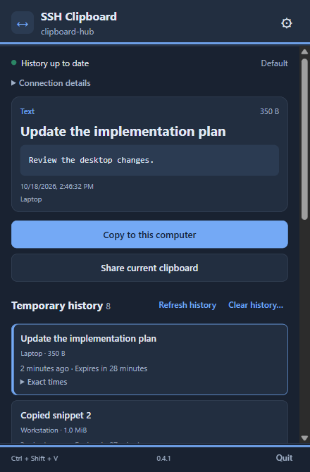

# ssh_clipboard

`ssh_clipboard` shares text and PNG clipboard content between machines over SSH. Sharing and copying are explicit; the app never auto-pastes into another application.

Your computers connect to a Linux server running `ssh_clipboard` through your existing SSH aliases, keys and host verification. Share an item from one computer, then select and copy it on another.

- Desktop packages: Windows x64 and Apple Silicon macOS.
- Server package: Linux x86_64, with bounded temporary history held in memory only.
- CLI: clipboard transfers, explicit stdin/file exports, shared settings and metadata diagnostics.



*Development screenshot; published packages may differ.*

## Set up the Linux server

Before connecting a desktop, you need a Linux x86_64 server account with SSH access and a functioning user systemd manager. The desktop does not install the server for you.

Follow [managed server setup](docs/server-setup.md) using the [signed server 0.4.0 release](https://github.com/johansigfrids/ssh_clipboard/releases/tag/server-v0.4.0). That guide covers first-install signature trust, installation, the SSH command route and a connection check. Use the explicit server release; desktop and server versions are released separately.

History is held in memory, expires automatically and is lost when the server restarts.

If you already run an older server, review [compatibility and cutover](docs/compatibility-and-cutover.md) before replacing it. The desktop can also connect to an existing single-item server in legacy mode.

## Install the desktop

[Download desktop 0.4.3](https://github.com/johansigfrids/ssh_clipboard/releases/tag/desktop-v0.4.3). Both packages include the desktop and matching CLI, with signed package verification for updates.

1. On Windows, run the per-user installer. On Apple Silicon Mac, extract the `.app.tar.gz` and move **SSH Clipboard.app** into a stable Applications folder before opening it.
2. In Settings, enter your server's SSH alias or `user@host`. Select **Temporary history (new server)** for the server configured above, or **Single shared item (legacy server)** for an older server. Apply and test the saved connection.
3. Use **Share current clipboard** to upload. On another computer connected to the same server account, select the item and choose **Copy to this computer**, then paste it into your application. Selecting or previewing history does not copy it.
4. Optionally enable **Start at login** in Behavior and configure shortcuts. Quit the old agent before enabling conflicting startup or shortcuts; installation does not remove it automatically.

The Mac app is ad-hoc signed without Apple notarization; use macOS per-app Privacy & Security approval if needed. See [first-install trust](docs/security.md#signed-package-trust). Intel Mac and Linux desktop have no supported package in this delivery.

## Settings and everyday behavior

Close hides the panel in the tray/menu bar; Quit exits. Configure panel and transfer shortcuts in Settings. Source builds default to Ctrl+Alt+Shift+S (Cmd+Option+Shift+S on Mac) to open the panel; existing saved bindings are preserved. See [shortcuts](docs/desktop-shortcuts.md) to change or restore the default. Updates offers explicit download/verification and a separate install confirmation.

Save connection settings before transferring; transfers use the saved configuration. Named profiles let you switch between servers, and the desktop and CLI share settings. See [shared settings](docs/shared-configuration.md) and [migration/recovery](docs/configuration-migration.md).

Temporary history refreshes automatically without reading or replacing your local clipboard. Panel Copy uses the selected history item, or the displayed snapshot on a legacy server. See [history controls](docs/desktop-history.md).

For connection failures or an interrupted Share, start with [troubleshooting](docs/troubleshooting.md) and [share recovery](docs/share-recovery.md). Transfer limits and reconnect details are in the [shelf client](docs/shelf-client.md) and [SSH sessions](docs/persistent-sessions.md) guides.

## CLI usage

Use `shelf` commands for the temporary-history server. After saving a connection in desktop Settings, these commands use the selected profile and this computer's saved device identity:

```text
ssh_clipboard shelf health
ssh_clipboard shelf share --file note.txt
ssh_clipboard shelf list
ssh_clipboard shelf fetch <item-uuid> --output received-note.txt
```

Replace `<item-uuid>` with an item's UUID from `list`. These commands read or write explicit files and leave the OS clipboard alone; an existing output file is never overwritten. Use `--stdin` instead of `--file` to share piped text, or add `--format png` when sharing a PNG file.

For CLI-only connection setup, see [shared settings](docs/shared-configuration.md#cli-selection-and-edits). See [shelf commands](docs/shelf-client.md) for direct targets, profile selection and more examples, or the [CLI reference](docs/cli.md) for all commands. Use `ssh_clipboard <command> --help` for flags.

## Legacy compatibility and support limits

The older V2 latest-item endpoint uses these commands. It needs an existing single-item server or the new server's explicitly configured V2 compatibility route:

```text
ssh_clipboard push --target user@server
ssh_clipboard pull --target user@server
ssh_clipboard peek --target user@server
ssh_clipboard doctor --target user@server
```

Here, `push` and `pull` use the local clipboard by default; `peek` and `doctor` inspect metadata. For file/stdin transfers and exports, see the [CLI reference](docs/cli.md). V2 and temporary-history SSH routes are separate; see [compatibility and cutover](docs/compatibility-and-cutover.md).

The old tray agent is retired from default builds and automatic releases. Its [explicit compatibility build](docs/legacy/agent.md) remains available through 0.4:

```text
cargo build --release --features agent
```

Frozen [v0.3.0 archives](https://github.com/johansigfrids/ssh_clipboard/releases/tag/v0.3.0), V2 routes and legacy import remain available under the [retirement policy](docs/legacy-retirement.md). Linux desktop is deferred. Native Mac image paste, browser-download Gatekeeper behavior and actual server reboot/logout remain recorded evidence limits; see the [closed delivery scope](docs/history/implementation-plan.md#deferred-and-non-blocking).

## Build from source

The default build includes the clipboard CLI. A Linux server/stdio-only build excludes native clipboard and desktop dependencies:

```text
cargo build --release
cargo build --release --no-default-features
```

For the desktop, use Node.js 24, Rust and [Tauri platform prerequisites](https://v2.tauri.app/start/prerequisites/), then from `desktop/`:

```powershell
npm ci
npm run tauri dev
```

Standalone development artifacts, settings isolation and resource guardrails are in [desktop development](docs/desktop-development.md). [Testing](docs/testing.md) lists Rust, frontend, package and documentation checks.

Source builds include UI improvements that may not be in published packages. The feature guides describe current source; [release evidence](docs/history/release-readiness.md) records exact package boundaries.

## Documentation

Start at the [docs index](docs/index.md) for current development, runtime and operations guides, legacy compatibility and dated acceptance history. Use [troubleshooting](docs/troubleshooting.md) for failures.

## License

MIT. See [LICENSE](LICENSE).

## Disclaimer

This project is 100% vibecoded and has not had human code review.
