# Desktop UI/UX Improvement Plan

## Purpose

Turn the owner's accepted 2026-10-18 UI/UX review into six independently reviewable PRs. Improve settings confidence, use of space, update information, and everyday interaction while retaining the app's visual identity and explicit transfer model.

**Status: PRs 1-4 merged; PR 5 implemented, pending review; PR 6 planned.** The owner accepted all review recommendations, authorized PRs 1-4's merges after CI, and authorized PR 5. PR numbers below describe delivery order; GitHub links and evidence are recorded as each PR is opened. This work is separate from the completed [original rework](implementation-plan.md).

## Key Files

- `desktop/src/App.svelte`, `style.css`: panel, settings, messages, focus, and layout.
- `desktop/src/api.ts`, `shortcut.js`: settings projection and shortcut display.
- `desktop/src-tauri/src/model.rs`, `panel.rs`: settings mapping, guarded Apply, and operation outcomes.
- `desktop/src-tauri/src/startup.rs`, `startup_native.rs`: actual login-entry state and rollback.
- `desktop/src-tauri/src/shortcuts.rs`, `notifications.rs`: registration and feedback capabilities.
- `desktop/scripts/build-installed.mjs`, `desktop-draft.mjs`, `.github/workflows/desktop-release.yml`: release notes and feed generation.
- `desktop/release-notes/`, `desktop/scripts/release-notes.mjs`, `desktop/src/update-notes.ts`: version-specific note authoring, admission, and safe presentation.
- `desktop/tests/panel.test.ts`, `shortcut.test.mjs`, `desktop-release.test.mjs`: existing frontend and delivery checks.

## Review Baseline and Decisions

The review used five owner screenshots, navigation of the installed Windows 0.4.1 app, and current source. It confirmed an empty history, settings scrolling, and a 0.4.2 update offer whose embedded notes still described an unreleased candidate. Populated history, keyboard flow, and failure/recovery screens were reviewed from source; they were not exercised natively in that session. Current checkout documentation has newer release wording than those embedded notes.

Use these decisions throughout the series:

- Keep the dark/light palette, familiar surfaces, four settings sections, and Share/Copy terminology. Recover space from repetition and spacing rather than reducing readable text size.
- Settings use explicit Apply/Discard. A checkbox edit is a draft, including Start at login after PR 2. Connection testing continues to test saved settings.
- Back and Escape retain an unsaved draft without applying it. Show a compact unsaved-settings indication on the panel, with a way back to settings and an explicit Discard action. Closing/hiding the panel must not silently apply changes.
- Apply/Discard operate on the whole settings draft across sections. Their visibility must not depend on the currently selected tab, including Updates.
- Preserve active-profile/revision checks, external-edit conflict handling, atomic saving, shortcut rollback, preview privacy, and actual startup-state reporting.
- Preserve explicit Share/Copy, selected-history copy semantics, direct Copy of the newest item, background-only direct shortcuts, confirmation, cancellation, and uncertain-share recovery.
- Preserve the latest transfer result in the panel even when a brief success notification disappears. Errors and unresolved operations remain discoverable and actionable.
- Ship these changes through ordinary code review. Creating this plan does not install a build, change live startup, alter published assets, or authorize a release.

## PR Sequence

Land in the order below, updating each branch against the previous merge. Most changes touch `App.svelte`; sequential PRs avoid overlapping layout and draft-state changes. Each PR must leave the app usable and include its own tests and documentation updates.

| PR | Suggested title | Size and boundary | Dependency |
| --- | --- | --- | --- |
| 1 | Clarify settings drafts and keep save actions visible | Medium; frontend state/navigation and settings action bar | None |
| 2 | Apply startup changes with the settings draft | Medium; focused frontend/backend save transaction | PR 1 |
| 3 | Show clear update actions and version-specific release notes | Medium; update presentation and release-note inputs | PR 2 for sequence; otherwise independent |
| 4 | Compact the panel and standardize button treatments | Medium; layout, hierarchy, and shared control styles | PR 1 and PR 3 |
| 5 | Simplify messages and organize behavior and shortcut settings | Medium; feedback lifecycle, copy, and grouping | PR 2 and PR 4 |
| 6 | Improve history scanning and keyboard navigation | Medium; time display, focus, and accessible navigation | PR 4 and PR 5 |

### PR 1: Clear Draft State and Persistent Save Actions

**Delivery record (2026-10-18):** [GitHub PR #12](https://github.com/johansigfrids/ssh_clipboard/pull/12), merged as `b775246` after all seven CI checks passed at head `26ba7b6`. `npm test` passes 60 rendered contracts and 19 Node/tooling tests; `npm run build` reports zero Svelte errors/warnings and builds successfully. Required `cargo clippy --features agent -- -D warnings` passes.

Synthetic browser inspection confirms all four sections retain the save bar at 440 x 670 and 340 x 440, without horizontal overflow or overlap. Real browser Enter saves a valid draft and native constraints block an invalid port. Back/Return retains edits, and Discard works from Updates. Light/default and dark/minimum screenshots were inspected. These checks use mock IPC/history and do not establish native Tauri hiding/reopening or OS registration; production settings, startup, clipboard, installations, and published assets were untouched.

Before/after at 440 x 670 in the light theme, with the same unsaved connection-name edit. The baseline is `d347bfb`; the after image shows the persistent save actions and truthful draft state:

| Before | After |
| --- | --- |
| 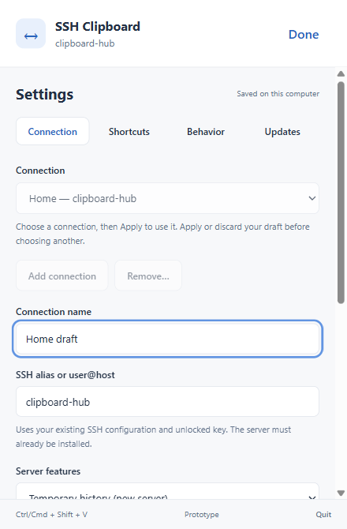 | 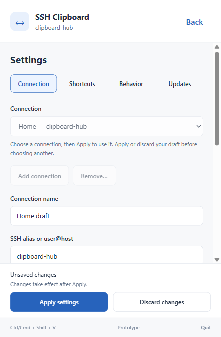 |

**Problem:** "Saved on this computer" describes the existence of a saved file, not whether visible edits are applied. Done retains a draft, while Apply/Discard are below the fold.

**Implementation:**

- Replace Done with Back. Show Unsaved changes when the draft differs from saved settings; show a distinct conflict state for an externally changed revision.
- Move Apply settings and Discard changes outside the scrolling form content into a persistent settings action bar. Keep them reachable in every settings section, including Updates, with current busy/recording/conflict guards.
- Keep form submission and Enter behavior deliberate. Navigation, update actions, and secondary controls must never submit the settings form accidentally.
- Retain drafts through Back, Escape, tab changes, and panel hiding. Add the compact panel indication described above; transfers continue to use the active saved settings.
- Keep a short "Changes take effect after Apply" cue with the draft state, so preview privacy changes cannot be mistaken for immediate changes.
- Keep Start at login's immediate-save explanation accurate in this PR; PR 2 removes that exception.

**Acceptance and verification:**

- An edit shows Unsaved changes and enables Apply/Discard; navigation alone issues no save, SSH, startup, or clipboard command.
- Apply uses the draft revision; failure keeps edits available and never claims they were saved. Discard loads the latest saved settings, including after an external conflict.
- Save controls remain visible without covering fields or focused controls at default and minimum window sizes. Opening Updates with edits retains access to them; installing an update remains blocked by a draft.
- Extend the existing rendered state/command tests and inspect actual browser layout; DOM tests alone do not establish visibility.

**Docs:** refresh `shared-configuration.md`, `desktop-prototype.md`, and relevant README settings guidance.

### PR 2: One Save Model for Start at Login

**Delivery record (2026-10-18):** [GitHub PR #13](https://github.com/johansigfrids/ssh_clipboard/pull/13), merged as `315b087` after all seven CI checks passed at head `92a21d2`. Start at login now participates in the whole settings draft, and its explicit optional IPC choice joins one prepared save/activation transaction. The persisted schema is unchanged; the immediate-save command is removed.

`npm test` passes 64 rendered contracts and 19 Node/tooling tests. `npm run build`, desktop all-feature/all-target Clippy, required core/agent Clippy, and Rust formatting pass. Desktop all-feature tests pass 86 tests, with the existing disposable-SSH test left ignored. Eight focused backend tests use fake native registries and temporary stores to cover startup-only preservation, combined Apply, external/unknown/unavailable startup, stale/invalid/read-only requests, partial startup failure, shortcut failure, commit failure, and failed restoration.

Synthetic browser checks at 440 x 670 and 340 x 440 confirm combined draft editing, actual-state helper text, Back retention, Discard, and unrelated saves while startup is unknown, with no save-bar overlap. The before image uses merged PR 1 (`b775246`): another preference edit disables startup. The after image allows both edits to wait for Apply. These are mock IPC checks and screenshots; the combined transaction has no new native installed-app/login evidence, and production settings/startup/clipboard/installations remain untouched.

| Before | After |
| --- | --- |
| 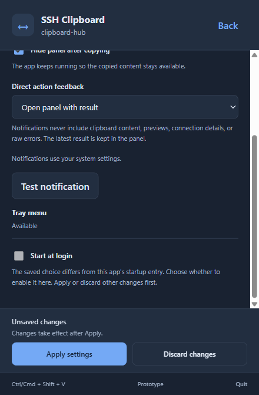 | 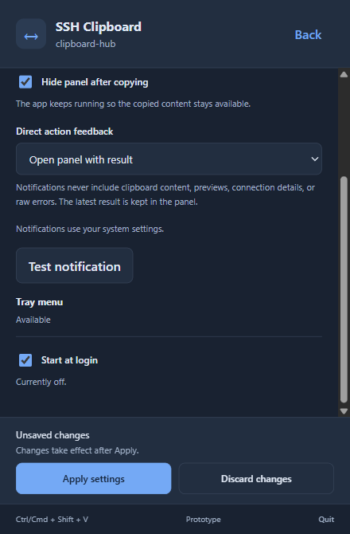 |

**Problem:** Start at login saves immediately, behaves differently from neighboring controls, and becomes disabled whenever another setting is edited.

**Implementation:**

- Make the startup checkbox edit an explicit pending startup choice. Retain separate actual OS state, saved preference, and user intent; reading settings or importing a saved preference must never activate startup.
- Submit that explicit choice through Apply with the other edits. Use one prepared configuration write and a coordinated activation path rather than calling two independent save commands.
- Validate the revision and all settings before changing OS state. Extend existing startup/shortcut rollback so a startup, shortcut, or file-commit failure restores previous activation where possible and reports any restoration failure truthfully.
- An unrelated Apply must not repair or overwrite a startup entry changed externally. If the OS state is unknown, show that fact and keep startup editing unavailable while allowing unrelated valid settings to save.
- Discard performs no native startup change. A startup-only save preserves history, selection, preview, and pending-share state. Keep unavailable-build/platform guidance concise.
- Remove the immediate-save UI path once the unified path is in use. Keep the persisted schema compatible; an IPC/draft extension does not itself require a file-schema migration.

**Acceptance and verification:**

- Rendered tests establish draft-only toggling, combined Apply, Discard, and unchanged/unavailable startup behavior.
- Use fake native registries and temporary settings stores to cover stale revisions, startup failure, shortcut failure after startup activation, commit failure, rollback failure, and successful startup-only/combined changes.
- Preserve actual-versus-saved mismatch reporting. Automated reads/reloads must not call native registration.
- Native evidence, if needed, is a finite isolated installed-test-build check on supported Windows/Mac paths; do not change the owner's production login entry as a side effect of testing.

**Docs:** update `shared-configuration.md`, `desktop-updates.md`, relevant README guidance, and `ARCHITECTURE.md` for the coordinated activation boundary.

### PR 3: Trustworthy, Actionable Updates

**Delivery record (2026-10-18):** [GitHub PR #14](https://github.com/johansigfrids/ssh_clipboard/pull/14), merged as `eedb187` after all eight checks passed at head `52c1811` (seven CI jobs plus the disposable Mac updater preparation). Installed/available versions, status, and Download update now precede notes. Short exact-version bullets render as escaped text; longer, mismatched, or legacy notes retain their full inert text in a disclosure using the page's scroll area. Missing notes omit the section. Verification progress, cancellation, offer identity checks, dirty-settings/pending-share blocks, and explicit install confirmation remain in place.

Packaging now validates `desktop/release-notes/<version>.md` before credentials, compilation, or staging. Both platform feeds must match the reviewed source notes, which also supply the desktop draft description. Disposable test packages can use an explicit override under the same version/size/content contract. The checked-in 0.4.2 file is a source reference; existing published packages/feeds are unchanged, and future versions require their own reviewed notes and release authorization.

`npm test` passes 74 rendered contracts and 25 Node/tooling tests, including wrong/missing/oversized/draft notes, cross-platform/source disagreement, inert note content, and update phases. `npm run build` reports zero Svelte errors/warnings. Desktop all-feature tests pass 86 tests, with the existing disposable-SSH test ignored. Desktop all-feature/all-target Clippy, required core/agent Clippy, Rust formatting, and notes preflight pass.

Synthetic browser checks cover dark 440 x 670 and light 340 x 440 CSS viewports at browser scale 100%. At default size, the Download action moves from y=613 (below the scrolling content's y=541 bottom) to y=284. Rechecking keeps its position; keyboard Enter expands legacy notes without nested scrolling. At minimum size all actions are reachable and no horizontal overflow occurs. Checking, downloading, verifying, ready, failed, curated, legacy, and missing-note states were inspected. These checks use mock IPC; no new native installed updater, signed package, publication, or production-settings/clipboard changes were performed.

Before/after at 440 x 670 in the dark theme, with the same legacy changelog payload. The baseline is merged PR 2 (`315b087`); the after image keeps the payload available through What's new:

| Before | After |
| --- | --- |
| 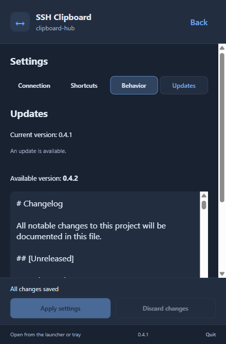 | 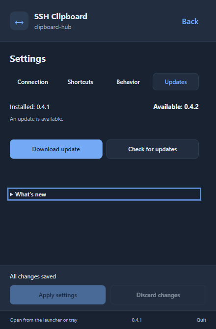 |

The same layout with the new concise version-specific notes:

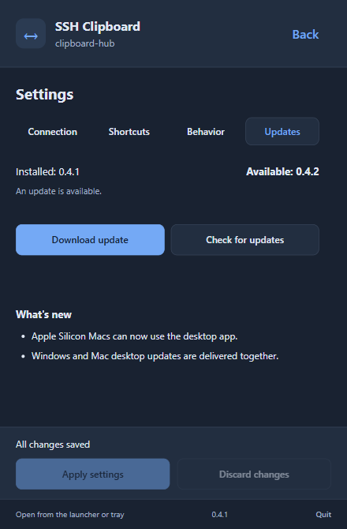

**Problem:** the whole repository changelog appears as raw Markdown before update actions. Historical and candidate-only wording contradicts the offered release.

**Implementation:**

- Put installed version, offered version, update state, and the available primary action before release notes. Use Download update, then verification progress/result, then the existing explicit Install and restart confirmation.
- Put concise What's new content after the actions. Use a disclosure for longer notes rather than a large nested scroll area dominating the page. Avoid the duplicate Updates heading.
- Add curated per-version desktop notes under `desktop/release-notes/<version>.md`. Start the format with an exact version heading and concise user-facing bullets; omit changelog boilerplate, older releases, internal acceptance logs, and candidate/publication-pending text from stable notes.
- Select and validate the exact requested version's notes before expensive packaging. Keep an explicit notes-file path for disposable test packages, validating the same version contract and existing size bound.
- Feed both platform stages from the same reviewed notes. Preserve combined-feed consistency checks and reuse the curated notes for desktop release descriptions where applicable; keep server release tooling separate.
- Treat notes as inert text or a narrowly rendered safe format. Do not introduce arbitrary HTML execution or change signature, trust, download, cancellation, or installation guards.
- Handle existing feeds with missing notes or a full historical changelog gracefully in the disclosure. Published immutable assets remain unchanged; corrected notes are generated for future releases.

**Acceptance and verification:**

- Fixture checks cover version mismatch/missing notes, empty/oversized input, stable candidate-only wording, and different platform notes. Do not require real production signing to test selection/admission.
- Frontend checks cover checking/offered/downloading/verifying/ready/error states, inert malicious notes, repeated checks without layout jumps, and protected install confirmation.
- Browser inspection confirms the primary update action is visible before notes at the default size; lengthy legacy notes cannot push it below the fold.

**Docs:** update `desktop-updates.md` and `releasing.md` with the curated-note authoring and input contract.

### PR 4: Compact Layout and Consistent Buttons

**Delivery record (2026-10-18):** [GitHub PR #15](https://github.com/johansigfrids/ssh_clipboard/pull/15), merged as `e71e2d2` after all seven CI jobs passed at head `af4e901`. The header/empty states/previews are more compact; shared button treatments retain primary, secondary, and quiet hierarchy. Copy remains above Share, with Share emphasized when nothing can be copied. History Refresh moves beside its heading; single-item/no-history Refresh remains below transfers. Settings navigation now has a fixed shell row above the scrolling form. Port and Identity file move into Advanced with values/SSH inheritance preserved and validation revealing the field.

`npm test` passes 78 rendered contracts and 25 Node/tooling tests. New cases cover contextual empty-history Refresh, collapsed port/key draft preservation/inheritance, native invalid-field disclosure, and backend validation returning from another section with the whole draft intact. `npm run build` reports zero Svelte errors/warnings; required core/agent Clippy passes.

Synthetic browser checks cover ten panel states (empty, short text, image, hidden preview, long labels, unchecked, legacy, unconfigured, busy/Cancel, uncertain share) in dark/light at 440 x 670 and 340 x 440: forty layouts without horizontal overflow or clipped grid columns. Ordinary empty/short-preview controls and history heading/first row meet the default fold target. The short fixture's first row ends at y=547 inside the content bottom y=629, versus baseline y=673 beyond y=632. Header height drops from 81 to 65 CSS pixels. Long text/images remain bounded; focus can scroll offscreen actions into view.

Settings checks cover both themes at 440 x 670, 340 x 440, and 700 x 900, including scrolling Advanced, switching all sections, persistent navigation/save controls, native Port constraints, and backend Timeout recovery. Minimum-size settings retain about 164 CSS pixels for content with no overlap. Tab traversal through all four sections keeps focused fields/controls reachable with outline clearance; Cancel invokes only the expected cancellation command. A separate 352 x 536 CSS viewport at device scale 1.25 checks 125%-equivalent rendering of a 440 x 670 window. Browser fixtures use fake IPC and synthetic content; there is no new native WebView/OS-scaling, clipboard, startup, installation, or publication evidence. Production state remains untouched.

Before/after at 440 x 670, dark theme, scale 100%, using merged PR 3 (`eedb187`) as baseline and the same synthetic short text/settings:

| Surface | Before | After |
| --- | --- | --- |
| Panel | 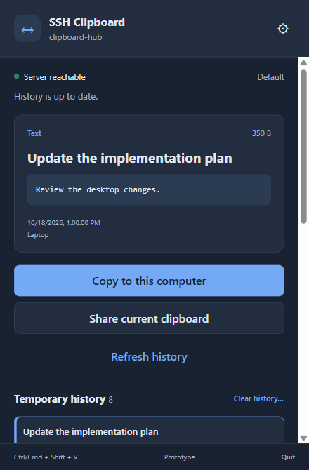 | 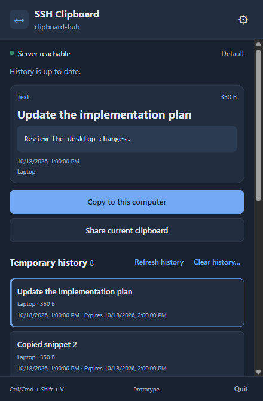 |
| Settings | 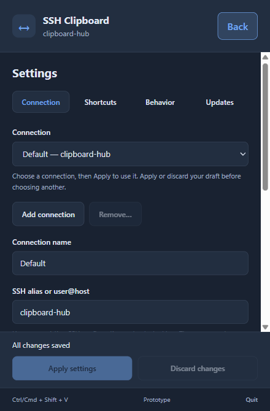 | 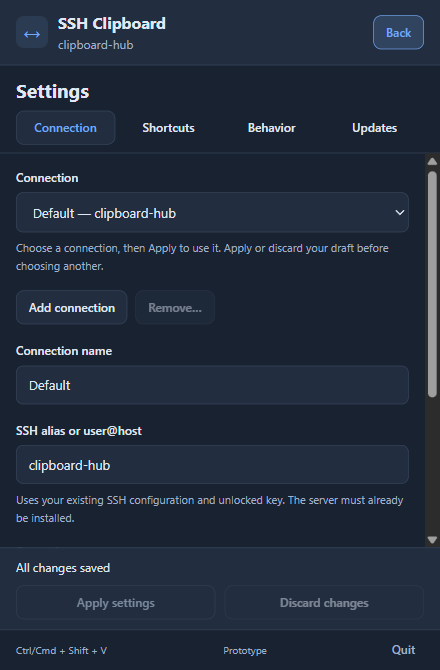 |

Minimum-size light settings (340 x 440 at 100%, scrolled to Advanced's end) and the 125%-equivalent light check (352 x 536 CSS, output 440 x 670, with an unsaved Port edit):

| Minimum | Scaled |
| --- | --- |
| 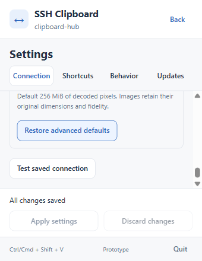 | 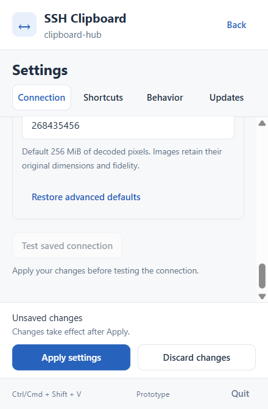 |

**Problem:** branding, empty-state space, and large secondary actions push history and settings controls down. Button emphasis is inconsistent, especially when Copy is disabled.

**Implementation:**

- Reduce header height and redundant vertical spacing while retaining connection identity and ellipsis for long targets. Keep footer actions compact.
- Shorten empty-state presentation. Preserve Share/Copy order and placement; emphasize Share when no item can be copied and make disabled Copy neutral.
- Move Refresh beside the history heading for history connections. Keep an obvious Refresh action for single-item connections and no-loaded-item states.
- Keep settings section navigation visible while its content scrolls. Coordinate its height with PR 1's save bar and preserve a useful scrollable area at minimum size.
- Move optional Port and Identity file into Advanced, retaining current values and SSH inheritance semantics. Reveal Advanced when validation points to a field inside it.
- Define primary, secondary, and quiet control treatments with consistent text sizes, padding, radius, hover, disabled, and focus states. Apply these to Test, Reset, Clear shortcut, navigation, update, profile, and recovery actions without flattening their hierarchy.
- Keep preview height bounded so a large image/text item cannot consume the whole initial viewport. Do not shrink the main text to meet fold targets.

**Acceptance and verification:**

- Inspect light and dark themes at 440 x 670 and 340 x 440 CSS viewports, plus a larger window and a higher text/zoom setting. Record viewport and scaling with screenshots.
- At default size in ordinary empty/short-preview states, main actions and the history heading/first row are visible. Exceptional errors/recovery messages may take priority; do not hide them to satisfy a fold target.
- At minimum size, all actions and fields remain reachable without horizontal scrolling, overlapping fixed areas, or clipped focus outlines.
- Exercise empty, unconfigured, hidden-preview, long-label, image, busy/Cancel, and uncertain-share fixture states. Use visual inspection for styling rather than tests that assert CSS class names.

**Docs:** refresh layout guidance in `desktop-prototype.md` and `desktop-history.md`.

### PR 5: Relevant Messages and Better Settings Grouping

**Delivery record (2026-10-18):** [GitHub PR #16](https://github.com/johansigfrids/ssh_clipboard/pull/16), pending review on `codex/contextual-feedback`. Healthy shelf state is one compact status with details on demand. Routine action confirmations stay in their originating section (in the settings save area), clear on navigation, and expire after five seconds. Errors have their own persistent presentation and explicit acknowledgement; timers never erase retained results, cancellation, capability warnings, or uncertain-share recovery. Panel and direct Share/Copy both retain their last backend outcome before returning/hiding; a compact result precedes recovery/history, with extra sentences in Details and failure detail initially expanded.

Behavior now groups Startup first, Clipboard panel, and Shortcut feedback as preferences for this computer across connections. Notification help/Test appear only for notification modes; the explicit test does not apply drafts. Normal tray availability and repeated panel narration are omitted, while unavailable/mismatch/conflict guidance stays. Shortcuts use a Background only cue and shorter complete Share/Copy/recording instructions. Successful registration reports Shortcuts active; errors still identify the affected action.

`npm test` passes 87 rendered contracts and 25 Node/tooling tests. Fake timers check expiry, replacement, newer warnings, navigation, and unmount cleanup; an in-flight Test returning after section navigation cannot resurrect stale success. Checks cover all four feedback modes, unsupported notifications/tray, startup mismatch, shortcut failure, quiet retained results and unresolved/cancelled shares without implicit transfers. Desktop all-feature tests pass 86 tests with the existing live-SSH test ignored. Desktop all-feature/all-target Clippy, required core/agent Clippy, Rust formatting, and frontend production build pass with zero Svelte errors/warnings.

Synthetic browser checks cover six states (healthy, unavailable capabilities, retained transfer, failed transfer, uncertain share, reconnect) across the panel, Behavior and Shortcuts in dark/light at 440 x 670 and 340 x 440: 24 state/theme/size combinations. Navigation issues only the two initial read commands. An explicit mocked notification test issues only its test command, leaves the draft unsaved, and does not transfer. Real browser checks confirm five-second success expiry, navigation cleanup, warning/result retention, and failed results before recovery. A dirty draft plus live confirmation still leaves 121 CSS pixels of usable minimum-size content without overlap or horizontal overflow. No new native notification/clipboard/startup/OS-scaling/installation or publication evidence is claimed; fixtures use mock IPC and production state is untouched.

Before/after at 440 x 670, dark theme, scale 100%, using merged PR 4 (`e71e2d2`) and the same synthetic settings/history:

| Surface | Before | After |
| --- | --- | --- |
| Panel | 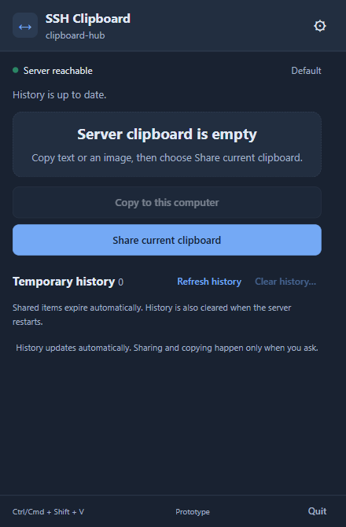 | 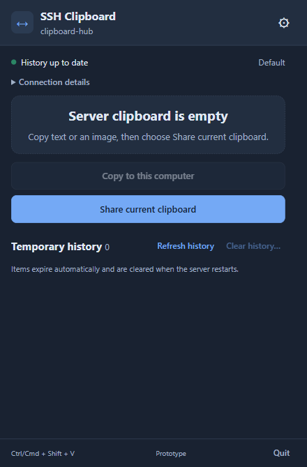 |
| Behavior | 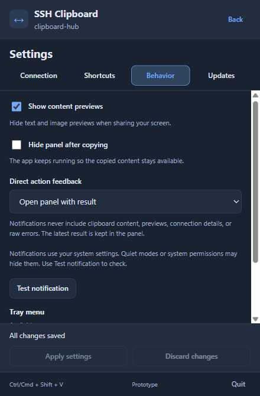 | 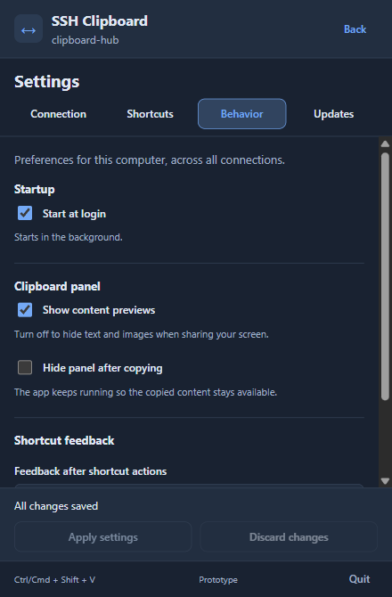 |
| Shortcuts | 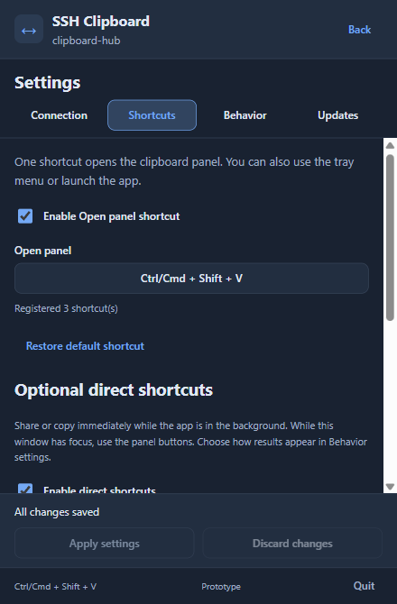 | 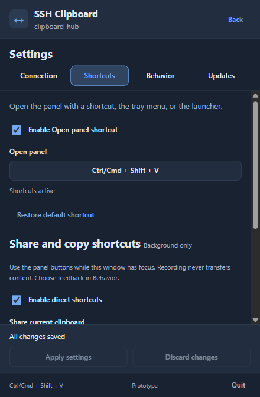 |

A failed uncertain share keeps its outcome and expanded detail above recovery:

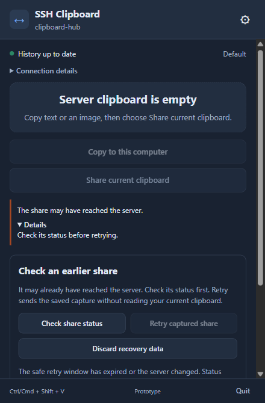

**Problem:** routine health, success, and explanatory text compete with actual tasks. Settings success follows the user into unrelated screens; important behavior choices sit below low-value diagnostics.

**Implementation:**

- Consolidate healthy connection/history status into one compact presentation. Show reconnect, stale-state, and failure detail when actionable; retain diagnostic detail on demand.
- Scope routine settings/Test/Reset successes to their action and clear them on navigation or after a short visible interval. Do not carry Settings applied into the clipboard panel or unrelated tabs.
- Retain the latest transfer outcome in a compact panel status with details available. Do not auto-dismiss errors, cancellation state, startup/shortcut repair warnings, or unresolved shares. Distinguish transient presentation from backend outcome retention.
- Remove routine Tray menu - Available and repeated healthy-state narration. Show capability failures/fallback entry points when needed.
- Move Start at login near the top of Behavior. Group preview/dismissal choices and shortcut-feedback preferences clearly, distinguishing global preferences from connection settings.
- Show notification troubleshooting and Test notification when a notification feedback mode is selected. Keep test delivery explicit and describe it as a test independent of unsaved preference changes.
- Shorten shortcut explanations while retaining background-only operation, Share sends the existing clipboard, Copy receives without pasting, and recording never transfers. Registration failure must still identify the affected action rather than report only a count.

**Copy targets:**

| Current | Planned wording/treatment |
| --- | --- |
| Registered 3 shortcut(s) | Shortcuts active; specific details on failure |
| Direct action feedback | Feedback after shortcut actions |
| Optional direct shortcuts | Share and copy shortcuts; visible Background only cue |
| Loaded current saved settings. | Changes discarded; brief, local feedback |
| History expiry explanation | Items expire automatically and are cleared when the server restarts. |
| Notification privacy paragraph | Notifications never show clipboard content. Retain broader privacy guarantees in docs. |

**Acceptance and verification:**

- Use fake timers to check transient success lifetime, navigation cleanup, replacement by a newer result, and cleanup on unmount. A stale timer must not dismiss a newer error.
- Verify errors/recovery survive routine updates and the latest direct-transfer outcome remains accessible after transient presentation ends, including quiet feedback mode.
- Test all feedback modes, unavailable tray/notifications, startup mismatch, shortcut conflict, and foreground shortcut explanation. Opening/editing settings never sends a test or transfers content.

**Docs:** update `desktop-notifications.md`, `desktop-shortcuts.md`, `connection-diagnostics.md`, and relevant README wording.

### PR 6: History Scanning and Keyboard Usability

**Problem:** history rows contain dense absolute timestamps, and current focus/navigation behavior has not received a focused review.

**Implementation:**

- Use relative receipt/expiry text for scanning, such as 2 minutes ago and Expires in 28 minutes. Offer exact localized timestamps through a keyboard-accessible detail/disclosure, not a hover-only tooltip.
- Update relative labels while visible without fetching payloads or rebuilding/reordering the history. Use readable byte units for larger items. Preserve selection by item ID and epoch.
- Show expired/unknown times truthfully; local clock formatting must never claim that the server has confirmed an item expired or remove it optimistically.
- Give the settings navigation complete accessible semantics. If implemented as tabs, include selected state, panel associations, arrow/Home/End behavior, and a predictable Tab sequence; avoid partial tab semantics.
- Set sensible focus on opening settings, returning to the panel, changing sections, and finishing confirmation. Keep focus and the preview discoverable after history selection without stealing it on passive updates.
- Format Ctrl/Command for the actual platform in displayed shortcuts. Retain canonical stored bindings and accessible recorder labels.
- Verify field-help associations, checked/selected states, status announcements, contrast, and focus visibility in both themes. Announce selection/results without repeatedly announcing background relative-time ticks.

**Acceptance and verification:**

- Deterministic-clock tests cover relative-time boundaries, unknown/future timestamps, exact-time access, large sizes, and timer cleanup. Formatting/ticks issue no transfer command and preserve selected IDs.
- Exercise keyboard-only navigation through all sections, Apply/Discard, recorders/Escape, update actions, history selection, and confirmation/cancellation with long-content fixtures.
- Check focus recovery when an item expires/disappears, a profile changes, or an error is displayed. Passive updates do not move focus or overwrite the clipboard.
- Finish with a bounded Windows/Mac native check only for focus, keyboard, OS scaling, or platform-key display that browser fixtures cannot prove. Record the tested build and remaining gaps; do not reopen broad migration/updater campaigns.

**Docs:** refresh `desktop-history.md`, `desktop-shortcuts.md`, and `desktop-prototype.md` with the verified interaction contracts.

## Verification and PR Completion

- Frontend PRs run `npm test` and `npm run build` from `desktop/`. Add behavior tests where state/command contracts change; use browser screenshots for spacing, fold, and control appearance.
- PR 2 additionally runs desktop Rust formatting, all-feature/all-target lint, and all-feature tests. PR 3 runs the existing Node release-tool checks with synthetic notes/feed fixtures. Existing CI remains required for every PR.
- Use temporary configuration, fake registries/IPC, and synthetic history/content for automated checks. Browser rendering is not evidence of native clipboard, shortcut, login, or installer behavior.
- Native checks are short and tied to concrete changed behavior. Prepare an isolated test build when needed, state expected outcomes, and guide owner actions one at a time. Keep production settings and published packages separate from test state.
- Each PR description states the user-visible change, relevant automated/visual evidence, and any native gap. Include representative before/after screenshots for visual changes.
- Update this plan after each PR: record its URL, status, verified outcomes, and any bounded follow-up. Refresh related docs with root cause and prevention guidance as contracts change.
- Update `README.md` for changed user workflows and `ARCHITECTURE.md` only where component or activation boundaries change. Implementation PRs should not bundle unrelated refactors, dependency upgrades, or a broad component rewrite.

## Coverage of the Accepted Review

| Review area | Delivery |
| --- | --- |
| Settings timing, misleading saved label, Done, hidden Apply/Discard | PR 1; startup exception closed in PR 2 |
| Above/below fold, optional connection fields, sticky navigation | PR 4; save bar in PR 1; update actions in PR 3 |
| Raw/contradictory update notes and hidden update controls | PR 3 |
| Informational clutter, stale feedback, labels, capability messages | PR 5; save/update wording in PRs 1 and 3 |
| Button sizing, emphasis, disabled Copy, contextual Refresh | PR 4 |
| Behavior/Shortcuts grouping and background-action expectations | PR 5 |
| History density, relative/exact time, keyboard/focus/accessibility | PR 6 |

## Update Triggers

- A PR starts, merges, changes scope, or establishes new evidence.
- A changed UI contract requires a different split or reveals a backend dependency.
- Native observations contradict the screenshot/source review or a planned acceptance criterion.

## Related Docs

- [Docs index](index.md), [writing conventions](writing-docs.md), [original rework](implementation-plan.md).
- [Shared configuration](shared-configuration.md), [desktop prototype](desktop-prototype.md), [architecture](../ARCHITECTURE.md).
- [History](desktop-history.md), [shortcuts](desktop-shortcuts.md), [notifications](desktop-notifications.md), [diagnostics](connection-diagnostics.md).
- [Desktop updates](desktop-updates.md), [release operations](releasing.md), [testing and native scheduling](testing.md).
